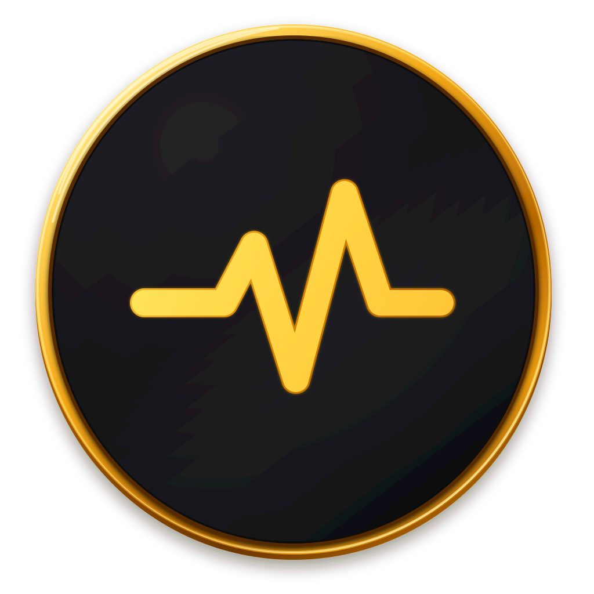
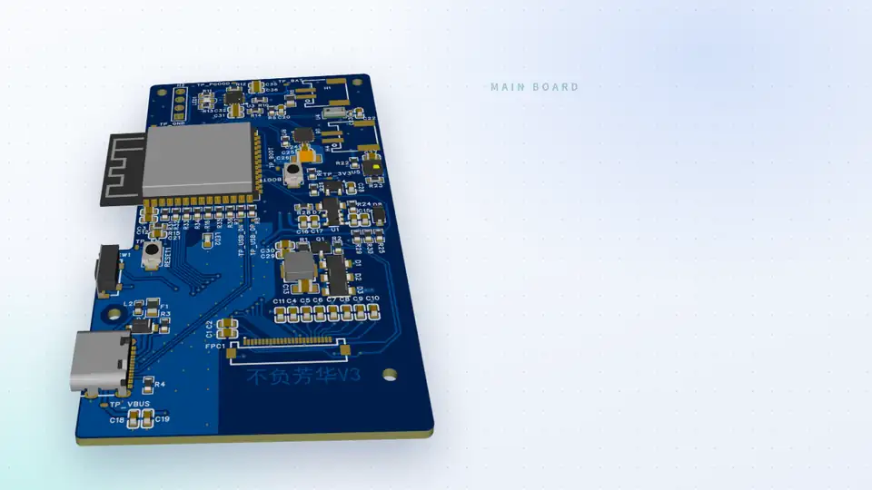
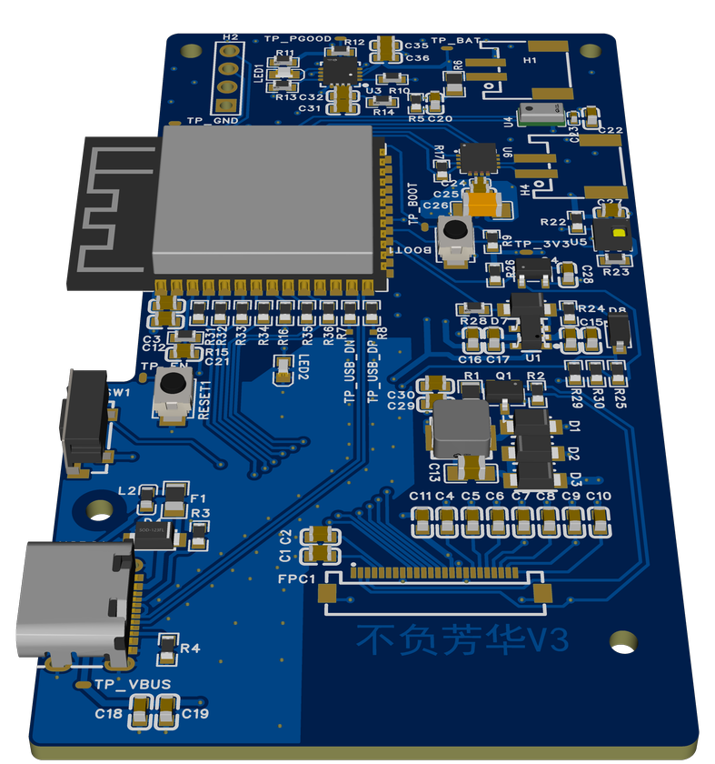
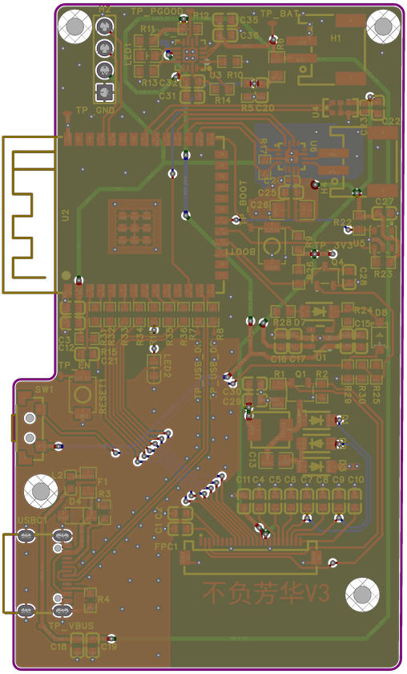
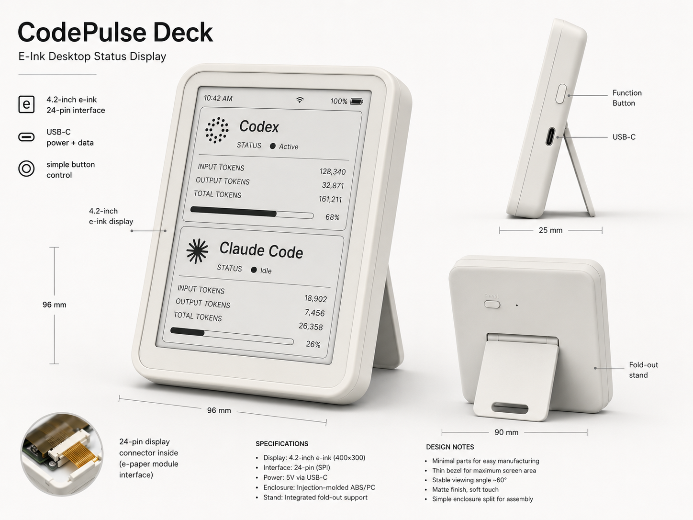
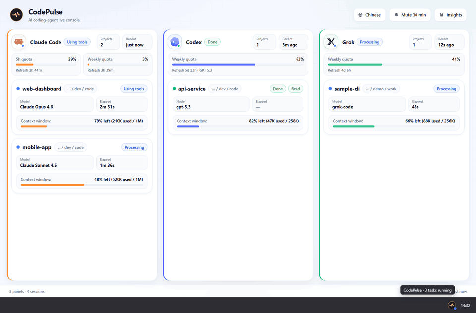
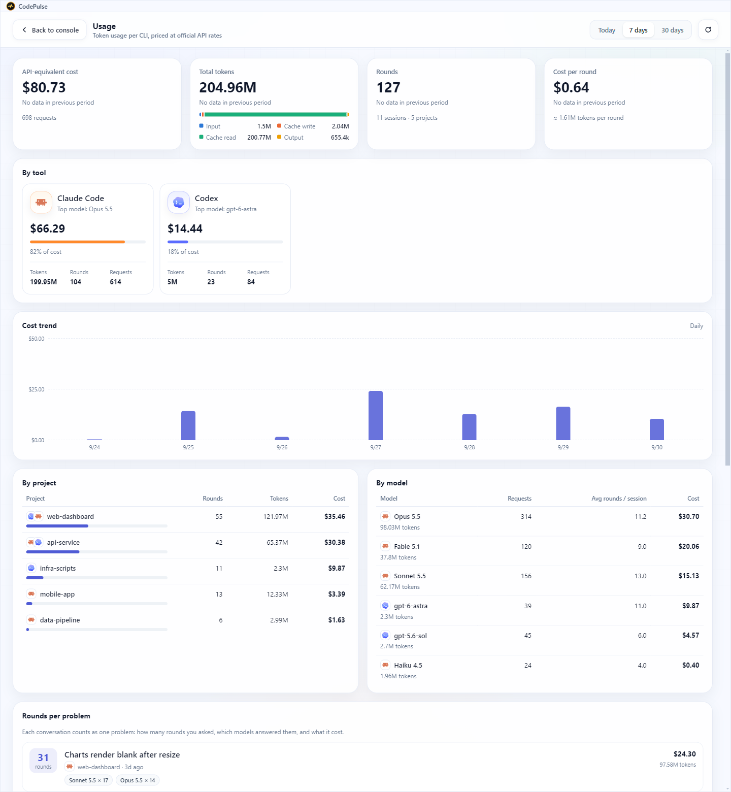

> **Temporary branch / 动态红色减闪实验：`codex/epd-red-flicker-lab`**
>
> 跨电脑继续测试请先读 [Board1 减闪交接与构建说明](firmware/doc/RED-REFRESH-HANDOFF.md)。
> `.48` 颜色正常但闪烁严重；`.49` 灰底失败；`.50` 减闪但黑色占优；[`.51` 像素错峰实验](firmware/doc/RED-STAGGER-LAB-2026-11-08.md) 用户反馈无改善。已停止硬件试验，按用户要求复盘证据与方法，不继续逐版试参。本分支不合并 main、不自动刷机。
> This is a source checkpoint for manual Board1 red-refresh experiments, not a firmware release.

> 家中实机轮次已结束。[精确源码归档与复放](firmware/experiments/red-lab-handoff/2026-11-08/README.md)、[逐版结果](firmware/doc/RED-REFRESH-RESULTS-2026-11-08.md)和[审计记录](firmware/doc/RED-REFRESH-AUDIT-2026-11-08.md)供主开发机接续。用户已确认主开发机找回并验证原始OTP，本次不补采、不上传它，当前不操作设备。

<div align="center">



# CodePulse

**An open-source e-paper display that shows what your AI coding agents are doing.**

It sits on your desk and shows whether Claude Code, Codex and Grok are working, waiting for you or
done, so you stop checking the terminal. The desktop app that feeds it also works on its own.

[](#-the-hardware)
[](#-the-hardware)
[](https://github.com/noeigenstate/CodePulse/releases/latest)
[](#-download)
[](./LICENSE)

[English](./README.md) · [简体中文](./README.zh-CN.md)

**[🛠 Build your own](#-build-your-own)** · [📟 Hardware](#-the-hardware) · [💻 Desktop app](#-the-desktop-app)



<sub>▶ <a href="./docs/hardware/codepulse-hardware.mp4">Watch the HD video (MP4, 28 s)</a></sub>

</div>

## ✨ Why a desk display

<table>
<tr>
<td width="33%" valign="top">👀 <b>Always in view</b><br/>E-paper keeps the last screen without power and reads like paper, with no backlight.</td>
<td width="33%" valign="top">🚦 <b>Status at a glance</b><br/>Working, waiting for you or done, for Claude Code, Codex and Grok, with their remaining quota.</td>
<td width="33%" valign="top">📋 <b>More than status</b><br/>Todos and reminders, room temperature and humidity, and battery level.</td>
</tr>
<tr>
<td valign="top">🔋 <b>Made for a desk</b><br/>USB-C, Li-ion battery charging and one-button power on and off.</td>
<td valign="top">🔓 <b>Open end to end</b><br/>Gerber, schematic, 3D model, firmware source and the desktop app all live in this repo.</td>
<td valign="top">🔒 <b>Stays on your network</b><br/>The display reads from your desktop over the LAN with its own token. No cloud involved.</td>
</tr>
</table>

## 📟 The hardware

> Board v3 adds the speaker and microphone and has not been verified on hardware yet. Read the
> [revision notes](./hardware/main-board/v3/README.md) before you order it.

<table>
<tr>
<td width="50%" align="center"></td>
<td width="50%" align="center"></td>
</tr>
<tr>
<td align="center"><b>3D render</b></td>
<td align="center"><b>4-layer layout</b></td>
</tr>
</table>

| Part           | Details                                                            |
| -------------- | ------------------------------------------------------------------ |
| **Controller** | ESP32-S3-WROOM-1-N16R8 with Wi-Fi and BLE, 16 MB flash, 8 MB PSRAM |
| **Display**    | 400×300 e-paper over a 24-pin FPC, with an on-board boost circuit  |
| **Audio**      | MAX98357A I²S amplifier and MSM261 PDM microphone                  |
| **Sensor**     | AHT20 temperature and humidity                                     |
| **Power**      | USB-C, BQ24075 Li-ion power-path charging and a soft power button  |
| **Board**      | 4 layers, 45.3 × 77.0 mm, designed in EasyEDA Pro                  |

| File                                                                                              | Use                                   |
| ------------------------------------------------------------------------------------------------- | ------------------------------------- |
| [`Gerber_主板_2026-10-31.zip`](./hardware/main-board/v3/exports/Gerber_主板_2026-10-31.zip)       | Upload to any PCB fab to order boards |
| [`SCH_电路原理图_2026-10-31.pdf`](./hardware/main-board/v3/exports/SCH_电路原理图_2026-10-31.pdf) | Schematic, 4 pages                    |
| [`3D_主板_2026-10-31.step`](./hardware/main-board/v3/exports/3D_主板_2026-10-31.step)             | 3D model for enclosure design         |

<p align="center"><br/><sub>Enclosure concept</sub></p>

## 🛠 Build your own

1. **Order the board.** Upload the Gerber zip to a PCB fab and choose 4 layers.
2. **Flash the firmware.** Follow the [firmware guide](./firmware/README.md), which uses ESP-IDF 6.0.1.
   The default build targets the earlier Board1 with audio off.
3. **Run the desktop app with the device API on.** The pairing screen is not in the v1.4.11 installers
   yet, so run it from source:

   ```bash
   pnpm install
   CODEPULSE_DEVICE_SERVER_ENABLED=1 pnpm dev
   ```

4. **Pair the display.** Open **Control**, choose **Connect Device** on the e-paper card, plug the
   display in over USB and enter your Wi-Fi details. It then reads status from the
   [LAN device API](docs/device-api-v1.md).

## 💻 The desktop app

The desktop app collects status from your agents' hooks and logs and serves it to the display. It
is just as useful without the hardware:

- 🚦 **One state machine.** Every agent reports the same states: running, waiting, done, error or stuck.
- 🔔 **Notified, not nagged.** A color-coded tray icon, plus optional toasts when a turn finishes or looks stuck.
- 🎟️ **Quota and context.** Claude 5-hour and weekly limits, Codex weekly quota and the context left in each session.
- 📈 **Usage and cost.** Exact tokens from each CLI's own logs, priced at official API rates.
- 🔒 **Local by default.** Loopback only, and nothing leaves your machine unless you use the assistant's AI or speech.

<p align="center"></p>

| Surface                 | What it does                                                                                |
| ----------------------- | ------------------------------------------------------------------------------------------- |
| **Desktop console**     | Control, multimedia, usage and settings in one window. Focus mode keeps only the dashboard. |
| **HUD**                 | An always-on-top floating window in five styles: panel, island, pills, edge drawer or orb.  |
| **E-paper workbench**   | Previews the 400×300 device screen pixel for pixel and saves what the display shows.        |
| **Tasks and assistant** | Local todos and reminders that can also appear on the e-paper display.                      |

<details>
<summary><b>Usage page</b></summary>

<p align="center"></p>

Exact tokens from each CLI's own logs, priced at official API rates, by tool, project and model.
Read it as what the API would have charged. <sub>Sample data shown.</sub>

</details>

## ⬇ Download

Get the desktop installer for your system from [GitHub Releases](https://github.com/noeigenstate/CodePulse/releases/latest).

| System              | File                                                          |
| ------------------- | ------------------------------------------------------------- |
| Windows             | `CodePulse_*_x64-setup.exe`                                   |
| macOS Apple Silicon | `CodePulse_*_mac-arm64.dmg`                                   |
| macOS Intel         | `CodePulse_*_mac-x64.dmg`                                     |
| Linux               | `CodePulse_*_x86_64.AppImage` or `CodePulse_*_arm64.AppImage` |

> The v1.4.11 installers contain the standard desktop app. To get the HUD, the e-paper
> workbench and the assistant now, [build from source](#-development).

<details>
<summary><b>macOS says “CodePulse is damaged and can’t be opened”</b></summary>

The app is not damaged. The builds are unsigned, so macOS quarantines them after download.
Move the app to Applications, then clear the flag:

```bash
xattr -cr /Applications/CodePulse.app
open /Applications/CodePulse.app
```

“Open Anyway” in Privacy & Security does not fix this dialog. Use the DMG that matches your chip.

</details>

<details>
<summary><b>macOS does not detect claude, codex, grok or kimi</b></summary>

Apps opened from Finder do not load your shell `PATH`. CodePulse checks the usual install
locations. If detection still fails, point it at the CLIs and relaunch:

```bash
launchctl setenv CLAUDE_CLI_PATH "$(which claude)"
launchctl setenv CODEX_CLI_PATH "$(which codex)"
launchctl setenv GROK_CLI_PATH "$(which grok)"
launchctl setenv KIMI_CLI_PATH "$(which kimi)"
```

</details>

<details>
<summary><b>Run the Linux AppImage</b></summary>

```bash
chmod +x CodePulse_*_x86_64.AppImage   # use arm64 on ARM machines
./CodePulse_*_x86_64.AppImage
```

</details>

## 🚀 First run

1. Open CodePulse. It checks your Claude Code, Codex, Grok and Kimi Code setup.
2. It adds only its own hook and status-line entries to each CLI's config. Your hooks,
   models and plugins stay as they are.
3. For Codex, run `/hooks` in a project terminal and trust the CodePulse hook if asked.
4. Start any agent task. A pane appears for each CLI that reports activity.

CodePulse saves each original config before its first edit, and uninstalling restores it.
On macOS and Linux, choose **Restore CLI configs & quit** from the tray menu, or run
`CodePulse --cleanup-config`, before deleting the app. Windows restores them automatically.

<details>
<summary><b>Files CodePulse edits</b></summary>

- `~/.claude/settings.json`
- `~/.codex/hooks.json` and `~/.codex/config.toml`
- `~/.grok/hooks/codepulse.json`
- `~/.kimi-code/config.toml`

The original versions are saved in `~/.codepulse/config-restore.json`.

</details>

To check that it works:

```bash
curl http://127.0.0.1:17888/api/health
```

### Tray colors

| Color     | Meaning                                 |
| --------- | --------------------------------------- |
| ⚪ Grey   | All idle                                |
| 🔵 Blue   | A task is running                       |
| 🟡 Yellow | Waiting for your permission or input    |
| 🟢 Green  | A turn finished and you have not looked |
| 🔴 Red    | An error                                |
| 🟠 Orange | Probably stuck                          |

Desktop notifications are off by default. Turn on **Real-time notifications** in Settings.

## ⚙️ How it works

```
 Codex / Claude Code / Grok / Kimi Code
   │  lifecycle hooks, native logs and the Codex App Server
   ▼
 POST /api/events ──► adapters ──► StatusHub (state machine + rules)
 (loopback only)                        │
                                        ├─► SQLite history
                                        ├─► tray icon and notifications
                                        ├─► desktop console and HUD
                                        └─► LAN device API ──► e-paper display
```

```
apps/desktop/     Electron main process, desktop console and e-paper workbench
apps/hud/         HUD renderer, sharing the same host
packages/         Shared types, state machine, adapters, storage, local server, hooks
firmware/         ESP32-S3 firmware, production renderer and fonts
hardware/         PCB designs by board and revision
tests/            Unit tests
```

Development targets `main`; desktop, HUD and firmware share one repository. See
[workspace and validation](docs/WORKSPACE.md) and [repository policy](docs/REPOSITORY.md).

Built with Electron, TypeScript, React, Tailwind, Fastify, better-sqlite3 and Drizzle ORM.

<details>
<summary><b>Local API</b></summary>

The API listens on `127.0.0.1:17888` only. Set `CODEPULSE_URL` to point the hooks elsewhere.

| Method | Path                 | Purpose                                          |
| ------ | -------------------- | ------------------------------------------------ |
| `POST` | `/api/events`        | Ingest a hook payload, or an array of up to 1000 |
| `GET`  | `/api/status`        | Full status snapshot                             |
| `GET`  | `/api/device/status` | Minimal status for light clients                 |
| `GET`  | `/api/agents/detect` | Detect the installed CLIs and hooks              |
| `POST` | `/api/ack/:agent`    | Mark an agent's result as read                   |
| `GET`  | `/api/health`        | Liveness probe                                   |
| `WS`   | `/ws`                | Pushes `status` and `notification` messages      |

The LAN device API on port `17889` is off by default and requires its own device token.
Task status is read-only and shares only project basenames; optional assistant and
work-voice routes provide their own bounded operations. See [LAN device protocol v1](docs/device-api-v1.md).

</details>

## 🔒 Privacy

- Status and usage data stay on your machine in one SQLite file in the app's user-data folder.
- Prompts are stored as short previews, and raw events older than 30 days are pruned.
- The Usage page reads your CLI logs on-device and uploads nothing.
- The assistant's AI and speech features send a request to the provider you configure, and only
  when you use them.
- Delete the database file to reset all history. It is at:
  - Windows: `%APPDATA%\CodePulse\codepulse.sqlite`
  - macOS: `~/Library/Application Support/CodePulse/codepulse.sqlite`
  - Linux: `~/.config/CodePulse/codepulse.sqlite`

## 🔧 Development

You need Node.js 20 or later and pnpm 9 or later.

```bash
pnpm install
pnpm build && pnpm start   # build everything, including the HUD, then launch
pnpm dev                   # desktop with hot reload
pnpm typecheck && pnpm test && pnpm smoke && pnpm lint
```

See the [build and run guide](docs/WORKSPACE.md) for the full workflow. The firmware has its own
[build guide](firmware/README.md) and does not need to be installed for desktop work.

<details>
<summary><b>Packaging and releases</b></summary>

```bash
pnpm dist         # installer for the current system, in apps/desktop/release
pnpm dist:win     # Windows NSIS installer
pnpm dist:linux   # Linux AppImage for the host CPU
pnpm dist:mac     # macOS DMGs for arm64 and Intel
```

Pushing a `v*` tag runs the release workflow. It builds and tests on all three systems, then
publishes one GitHub Release. The release notes come from `docs/release-notes/vX.Y.Z.md`.
macOS builds are unsigned.

</details>

<details>
<summary><b>Troubleshooting</b></summary>

- **The console never leaves “waiting for events”.** Check that
  `curl http://127.0.0.1:17888/api/health` returns `{"ok":true}`, and that setup reports no
  missing hooks. For Codex, trust the hook with `/hooks`.
- **“SQLite unavailable”.** The native module was built for the wrong runtime. Run
  `pnpm --filter @codepulse/desktop rebuild:electron`.
- **Port 17888 is in use.** Quit the other instance from its tray menu.
- **pnpm did not build better-sqlite3 or electron.** Run `pnpm install` again, or `pnpm rebuild`.

</details>

## 🤝 Contributing

Issues and pull requests are welcome. For firmware, hardware or cross-surface changes, read the
[repository guide](docs/REPOSITORY.md) first. For desktop code, run `pnpm typecheck && pnpm test && pnpm smoke` and
`pnpm format` before you submit, and keep each PR to one concern.

## License

The software is [MIT](./LICENSE) licensed © 2026 CodePulse Contributors. Fonts and components keep
[their own notices](firmware/THIRD-PARTY-NOTICES.md). Each hardware revision states its own design
license.
