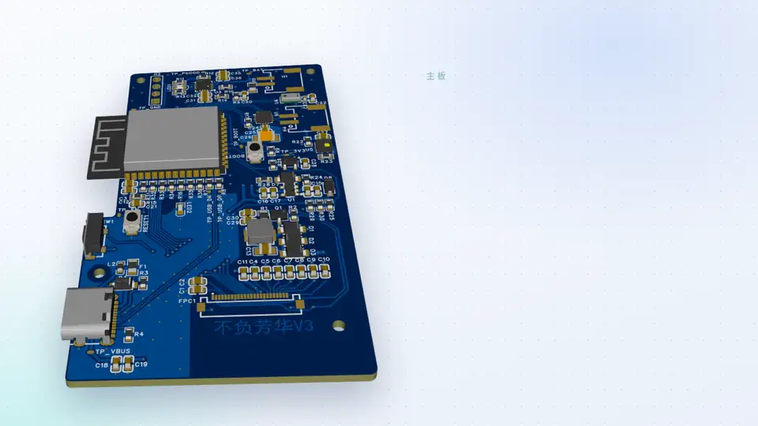
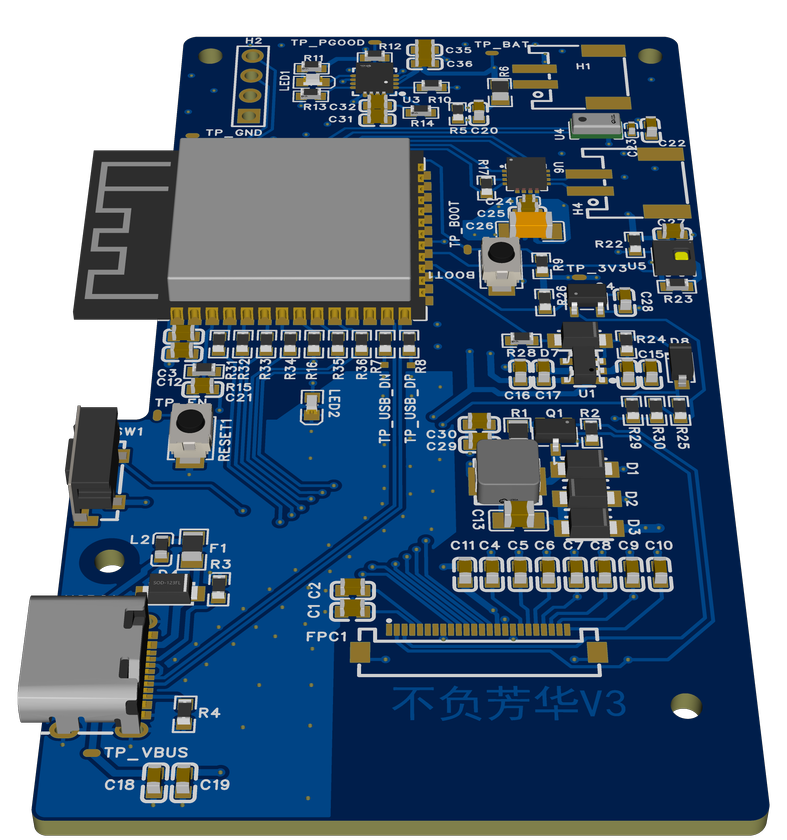
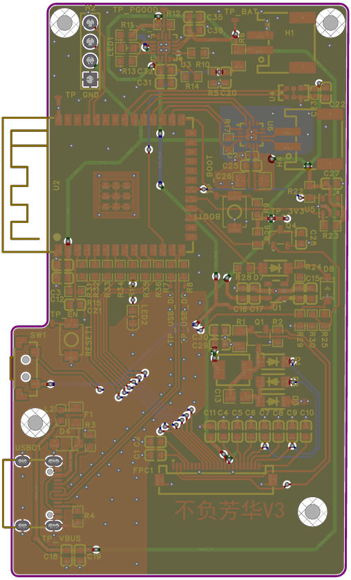
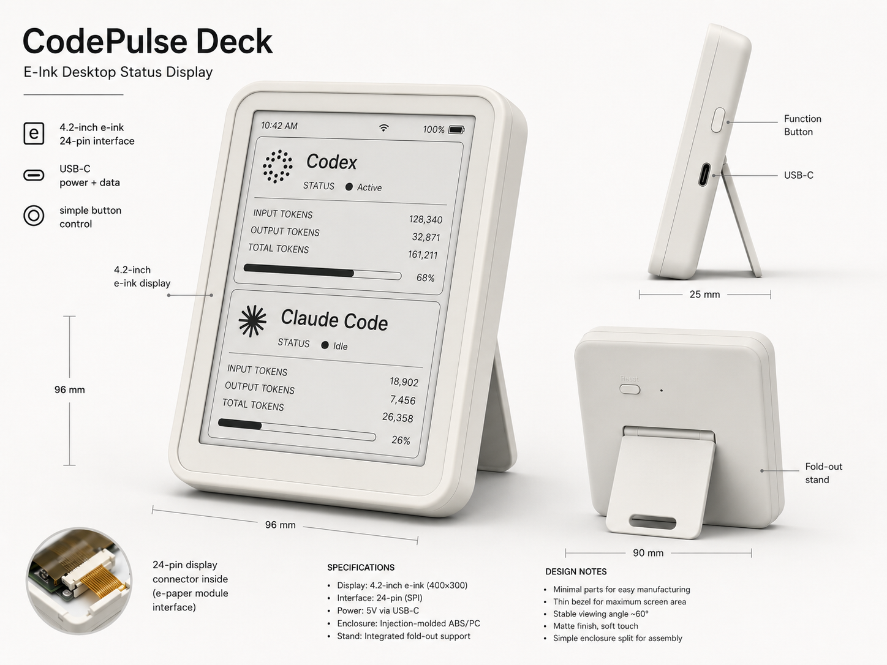
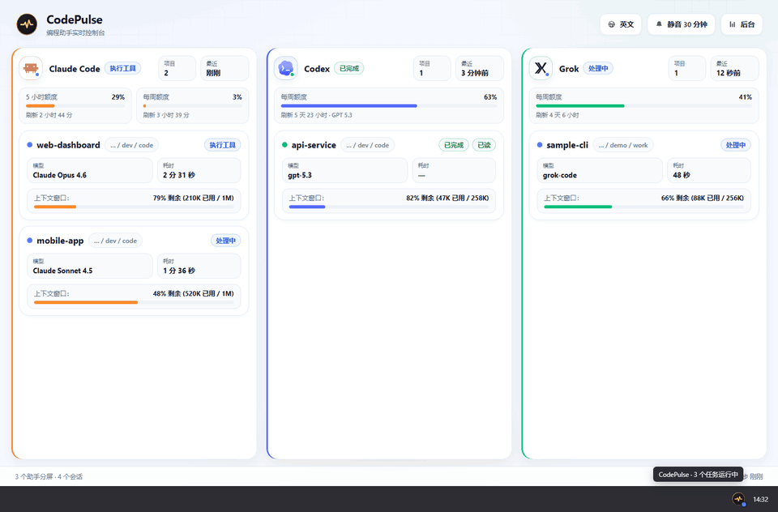
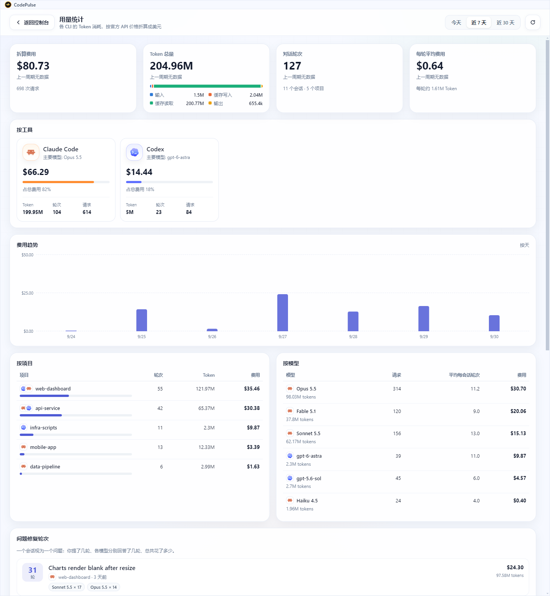

<div align="center">


# CodePulse / 码脉

**开源墨水屏桌面终端，一眼看清 AI 编程代理在做什么。**

它放在桌上，显示 Claude Code、Codex 和 Grok 正在工作、在等你处理还是已经完成，不用再反复切回终端。给它供数据的桌面应用也能单独使用。

[](#-硬件)
[](#-硬件)
[](https://github.com/noeigenstate/CodePulse/releases/latest)
[](#-下载)
[](./LICENSE)

[English](./README.md) · [简体中文](./README.zh-CN.md)

**[🛠 自己做一台](#-自己做一台)** · [📟 硬件](#-硬件) · [💻 桌面应用](#-桌面应用)



<sub>▶ <a href="./docs/hardware/codepulse-hardware-zh.mp4">观看高清视频（MP4，28 秒）</a></sub>

</div>

## ✨ 为什么要一块桌面屏

<table>
<tr>
<td width="33%" valign="top">👀 <b>一直在视线里</b><br/>墨水屏断电也保留画面，像纸一样好读，没有背光刺眼。</td>
<td width="33%" valign="top">🚦 <b>状态一眼看清</b><br/>Claude Code、Codex 和 Grok 在工作、等你处理还是已完成，以及剩余额度。</td>
<td width="33%" valign="top">📋 <b>不止看状态</b><br/>待办和提醒、室内温湿度、电池电量。</td>
</tr>
<tr>
<td valign="top">🔋 <b>为桌面设计</b><br/>USB-C 供电，锂电池充电，一键开关机。</td>
<td valign="top">🔓 <b>从头到尾开源</b><br/>Gerber、原理图、3D 模型、固件源码和桌面应用都在这个仓库里。</td>
<td valign="top">🔒 <b>只在局域网内</b><br/>屏幕通过局域网从你的电脑读取状态，使用独立 token，不经过云端。</td>
</tr>
</table>

## 📟 硬件

> V3 主板新增了喇叭和麦克风，还没有经过实机验证。下单前请先看[修订说明](./hardware/main-board/v3/README.md)。

<table>
<tr>
<td width="50%" align="center"></td>
<td width="50%" align="center"></td>
</tr>
<tr>
<td align="center"><b>3D 渲染</b></td>
<td align="center"><b>4 层板布局</b></td>
</tr>
</table>

| 部分       | 规格                                                         |
| ---------- | ------------------------------------------------------------ |
| **主控**   | ESP32-S3-WROOM-1-N16R8，Wi-Fi + BLE，16 MB Flash，8 MB PSRAM |
| **屏幕**   | 400×300 墨水屏，24-pin FPC 接口，板载升压电路                |
| **音频**   | MAX98357A I²S 功放，MSM261 PDM 麦克风                        |
| **传感器** | AHT20 温湿度传感器                                           |
| **电源**   | USB-C 供电，BQ24075 锂电池充电与电源路径管理，按键开关机     |
| **板子**   | 4 层板，45.3 × 77.0 mm，嘉立创 EDA 专业版设计                |

| 文件                                                                                              | 用途                       |
| ------------------------------------------------------------------------------------------------- | -------------------------- |
| [`Gerber_主板_2026-10-31.zip`](./hardware/main-board/v3/exports/Gerber_主板_2026-10-31.zip)       | 上传到任意板厂即可下单打板 |
| [`SCH_电路原理图_2026-10-31.pdf`](./hardware/main-board/v3/exports/SCH_电路原理图_2026-10-31.pdf) | 电路原理图，共 4 页        |
| [`3D_主板_2026-10-31.step`](./hardware/main-board/v3/exports/3D_主板_2026-10-31.step)             | 3D 模型，用于设计外壳      |

<p align="center"><br/><sub>外观概念图</sub></p>

## 🛠 自己做一台

1. **打板。** 把 Gerber 压缩包上传到板厂，选择 4 层板。
2. **刷固件。** 按[固件说明](./firmware/README.md)操作，使用 ESP-IDF 6.0.1。默认构建针对早期的 Board1，音频关闭。
3. **开启设备 API 运行桌面应用。** 局域网设备 API 默认关闭，需要带上 `CODEPULSE_DEVICE_SERVER_ENABLED=1` 启动，例如从源码运行：

   ```bash
   pnpm install
   CODEPULSE_DEVICE_SERVER_ENABLED=1 pnpm dev
   ```

4. **配对。** 在左边栏打开 **墨水屏设备**，点 **连接设备**，用 USB 连接设备并填写 Wi-Fi，之后设备通过[局域网设备 API](docs/device-api-v1.md) 读取状态。

## 💻 桌面应用

桌面应用从代理的 hook 和日志收集状态，再提供给墨水屏。没有硬件也一样好用：

- 🚦 **统一状态机。** 所有代理都用同一套状态：运行中、等你处理、已完成、出错或卡住。
- 🔔 **该提醒才提醒。** 彩色托盘图标常驻；任务完成或疑似卡住时，可选弹出桌面通知。
- 🎟️ **额度与上下文。** Claude 5 小时和每周额度、Codex 每周额度，以及每个会话剩余的上下文。
- 📈 **用量与费用。** 从各 CLI 自己的日志读取精确 Token，按官方 API 价格折算。
- 🔒 **默认本地。** 只监听本机回环地址，除非使用助手的 AI 或语音功能，数据不会离开本机。

<p align="center"></p>

| 界面             | 作用                                                               |
| ---------------- | ------------------------------------------------------------------ |
| **桌面控制台**   | 一个窗口，左边栏通向工作台、悬浮窗、墨水屏设备、插件和用量与费用。 |
| **HUD**          | 置顶悬浮窗，可选面板、灵动岛、胶囊流、边缘抽屉、悬浮球五种样式。   |
| **墨水屏工作台** | 逐像素预览 400×300 设备画面，并保存墨水屏要显示的内容。            |
| **待办与助手**   | 本地待办和提醒，也可以显示到墨水屏上，在 **插件** 页管理。         |

在桌面控制台里，左边栏把页面分成三组：**工作空间**（工作台、悬浮窗）、**设备与扩展**（墨水屏设备、插件）和 **数据分析**（用量与费用）。

- **可收起。** 点边栏右上角的收起按钮，或按 `Ctrl+B`（macOS 为 `⌘B`；在文字输入框里不触发）。收起后只留 56 px 宽的图标栏，鼠标悬停或键盘聚焦图标时显示名称。CodePulse 会记住上次的收起状态。
- **底部状态条。** 边栏底部显示“运行正常 · N 个任务执行中”或“运行正常 · 空闲”。墨水屏的连接状态是“墨水屏设备”图标上的小圆点：空心表示未连接，实心绿点表示已连接。
- **Windows 上的窗口。** 没有单独的标题栏横条，CodePulse 标志和名字在边栏顶部，内容区一直延伸到窗口顶部，系统按钮浮在内容区上。
- **设置。** 设置在边栏最下方，里面有 **语音提醒** 和状态中英文对照；语音提醒分“工作台”“墨水屏设备”两个独立开关。

<details>
<summary><b>用量与费用页</b></summary>

<p align="center"></p>

从各 CLI 自己的日志读取精确 Token，按官方 API 价格折算，可按工具、项目和模型查看。订阅套餐不按 Token 计费，这里的费用是按 API 价格折算的参考值。<sub>图中为示例数据。</sub>

</details>

## ⬇ 下载

从 [GitHub Releases](https://github.com/noeigenstate/CodePulse/releases/latest) 下载对应系统的安装包。

| 系统                | 文件                                                          |
| ------------------- | ------------------------------------------------------------- |
| Windows             | `CodePulse_*_x64-setup.exe`                                   |
| macOS Apple Silicon | `CodePulse_*_mac-arm64.dmg`                                   |
| macOS Intel         | `CodePulse_*_mac-x64.dmg`                                     |
| Linux               | `CodePulse_*_x86_64.AppImage` 或 `CodePulse_*_arm64.AppImage` |

> 安装包包含完整的桌面应用：HUD、墨水屏工作台、插件和助手。

<details>
<summary><b>macOS 提示“CodePulse 已损坏，无法打开”</b></summary>

应用并没有损坏。安装包没有签名，下载后会被 macOS 隔离。把应用拖进“应用程序”后清除隔离标记：

```bash
xattr -cr /Applications/CodePulse.app
open /Applications/CodePulse.app
```

“隐私与安全性”里的“仍要打开”解决不了这个提示。请下载与芯片匹配的 DMG。

</details>

<details>
<summary><b>macOS 检测不到 claude、codex、grok 或 kimi</b></summary>

从访达打开的应用不会加载终端的 `PATH`。CodePulse 会检查常见安装位置；如果仍然检测不到，手动指定路径后重新打开：

```bash
launchctl setenv CLAUDE_CLI_PATH "$(which claude)"
launchctl setenv CODEX_CLI_PATH "$(which codex)"
launchctl setenv GROK_CLI_PATH "$(which grok)"
launchctl setenv KIMI_CLI_PATH "$(which kimi)"
```

</details>

<details>
<summary><b>运行 Linux AppImage</b></summary>

```bash
chmod +x CodePulse_*_x86_64.AppImage   # ARM 设备换成 arm64
./CodePulse_*_x86_64.AppImage
```

</details>

## 🚀 首次运行

1. 打开 CodePulse，它会检查 Claude Code、Codex、Grok 和 Kimi Code 的配置。
2. 它只在各 CLI 配置里添加自己的 hook 和状态栏条目，你原有的 hook、模型和插件都会保留。
3. 使用 Codex 时，在项目终端运行 `/hooks`，按提示信任 CodePulse 的 hook。
4. 运行任意代理任务，有活动的 CLI 会自动出现对应面板。

CodePulse 首次修改配置前会备份原文件，卸载时自动还原。macOS 和 Linux 删除应用前，请先在托盘菜单选择 **还原 CLI 配置并退出…**，或运行 `CodePulse --cleanup-config`。Windows 卸载时会自动还原。

<details>
<summary><b>CodePulse 会修改的文件</b></summary>

- `~/.claude/settings.json`
- `~/.codex/hooks.json` 和 `~/.codex/config.toml`
- `~/.grok/hooks/codepulse.json`
- `~/.kimi-code/config.toml`

原始版本备份在 `~/.codepulse/config-restore.json`。

</details>

检查是否正常运行：

```bash
curl http://127.0.0.1:17888/api/health
```

### 托盘颜色

| 颜色    | 含义                   |
| ------- | ---------------------- |
| ⚪ 灰色 | 全部空闲               |
| 🔵 蓝色 | 有任务正在运行         |
| 🟡 黄色 | 等待你授权或输入       |
| 🟢 绿色 | 任务已完成，你还没查看 |
| 🔴 红色 | 出错                   |
| 🟠 橙色 | 疑似卡住               |

桌面通知默认关闭，可在设置中打开 **实时消息通知**。

## ⚙️ 工作原理

```
 Codex / Claude Code / Grok / Kimi Code
   │  生命周期 hook、原生日志与 Codex App Server
   ▼
 POST /api/events ──► 适配器 ──► StatusHub（状态机 + 规则）
 （仅本机回环）                       │
                                      ├─► SQLite 历史记录
                                      ├─► 托盘图标与通知
                                      ├─► 桌面控制台与 HUD
                                      └─► 局域网设备 API ──► 墨水屏
```

```
apps/desktop/     Electron 主进程、桌面控制台与墨水屏工作台
apps/hud/         HUD 界面，与桌面共用同一宿主
packages/         共享类型、状态机、适配器、存储、本地服务与 hook
firmware/         ESP32-S3 固件、量产渲染器与字体
hardware/         按板型和修订存放的 PCB 设计
tests/            单元测试
```

日常开发与推送统一使用 `main`；桌面、HUD 与固件共用根仓库。详见
[工作区与验证](docs/WORKSPACE.md)及[仓库约定](docs/REPOSITORY.md)。

技术栈：Electron、TypeScript、React、Tailwind、Fastify、better-sqlite3、Drizzle ORM。

<details>
<summary><b>本地 API</b></summary>

API 只监听 `127.0.0.1:17888`。设置 `CODEPULSE_URL` 可以让 hook 指向其他地址。

| 方法   | 路径                 | 用途                                 |
| ------ | -------------------- | ------------------------------------ |
| `POST` | `/api/events`        | 接收 hook 事件，或最多 1000 条的数组 |
| `GET`  | `/api/status`        | 完整状态快照                         |
| `GET`  | `/api/device/status` | 给轻量客户端的精简状态               |
| `GET`  | `/api/agents/detect` | 检测已安装的 CLI 和 hook             |
| `POST` | `/api/ack/:agent`    | 把代理结果标记为已读                 |
| `GET`  | `/api/health`        | 存活检查                             |
| `WS`   | `/ws`                | 推送 `status` 和 `notification` 消息 |

端口 `17889` 上的局域网设备 API 默认关闭，需要独立的设备 token。任务状态只读、项目只显示目录名；可选的助手及工作语音路由另提供范围受限的操作。详见[局域网设备协议 v1](docs/device-api-v1.md)。

</details>

## 🔒 隐私

- 状态和用量数据都在本机，保存在应用数据目录下的一个 SQLite 文件里。
- 提示词只存简短摘要，超过 30 天的原始事件会自动清理。
- 用量与费用页只在本机读取 CLI 日志，不上传任何数据。
- 只有在你使用助手的 AI 或语音功能时，请求才会发送给你配置的服务商。
- 删除数据库文件即可清空全部历史，文件位置：
  - Windows：`%APPDATA%\CodePulse\codepulse.sqlite`
  - macOS：`~/Library/Application Support/CodePulse/codepulse.sqlite`
  - Linux：`~/.config/CodePulse/codepulse.sqlite`

## 🔧 开发

需要 Node.js 20 及以上和 pnpm 9 及以上。

```bash
pnpm install
pnpm build && pnpm start   # 构建全部内容（含 HUD）并启动
pnpm dev                   # 桌面版热重载开发
pnpm typecheck && pnpm test && pnpm smoke && pnpm lint
```

完整流程见[构建启动说明](docs/WORKSPACE.md)。固件有单独的[构建说明](firmware/README.md)，桌面开发不需要安装固件工具链。

<details>
<summary><b>打包与发版</b></summary>

```bash
pnpm dist         # 打包当前系统的安装包，输出到 apps/desktop/release
pnpm dist:win     # Windows NSIS 安装包
pnpm dist:linux   # 当前 CPU 架构的 Linux AppImage
pnpm dist:mac     # macOS arm64 与 Intel 两个 DMG
```

推送 `v*` 标签会触发发版流程：在三个系统上构建和测试，然后发布一个 GitHub Release。发版说明取自 `docs/release-notes/vX.Y.Z.md`。macOS 安装包没有签名。

</details>

<details>
<summary><b>故障排查</b></summary>

- **控制台一直显示“等待事件”。** 确认 `curl http://127.0.0.1:17888/api/health` 返回
  `{"ok":true}`，并且配置检查没有提示缺少 hook。Codex 需要用 `/hooks` 信任 hook。
- **提示“SQLite unavailable”。** 原生模块的运行时不匹配，运行
  `pnpm --filter @codepulse/desktop rebuild:electron`。
- **端口 17888 被占用。** 从托盘菜单退出另一个实例。
- **pnpm 没有构建 better-sqlite3 或 electron。** 重新运行 `pnpm install`，或运行 `pnpm rebuild`。

</details>

## 🤝 参与贡献

欢迎提交 Issue 和 Pull Request。涉及固件、硬件或跨端的改动，请先阅读[仓库协作说明](docs/REPOSITORY.md)。桌面代码提交前请运行 `pnpm typecheck && pnpm test && pnpm smoke`
和 `pnpm format`，每个 PR 只做一件事。

## 许可证

软件基于 [MIT 许可证](./LICENSE) 发布 © 2026 CodePulse Contributors。字体和组件保留[各自的许可](firmware/THIRD-PARTY-NOTICES.md)，每个硬件修订单独说明设计许可。
