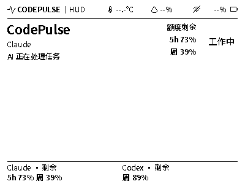
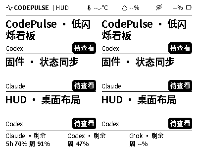

# 日常低干扰显示 · 0.0.26

更新：2026-10-29。配套固件提交 `7e3d9e6` 已推送并合入独立固件仓库的
`main`。产品基线为 `f275dab`；本轮仅同步两套墨水屏预览与文档，产品继续在
`codex/unified-product` 开发，不合并产品 `main`。

## 展示规则与兼容性

- 沿用设备协议 v1，不增加字段，不改变共享任务、已读、保留、排序或 HUD 行为。
- 设备将同一活动任务的 thinking/tool_running 等子阶段显示为稳定的“工作中”
  和“AI 正在处理任务”，子阶段切换本身不触发物理刷新。
- 新任务、完成未读、待授权、待补充输入、异常及解除提醒仍及时显示。
- 已知额度采用 120 秒展示节奏；未知转已知、达到限额例外。温湿度和电量
  保留阈值及 15 分钟限制，工作变化后辅助区另留 60 秒安静窗口。
- 同一 ambient ID 的图片、便签或内容在有效停留期间冻结页眉与额度。
  宿主因紧急提醒撤掉内容后，设备恢复工作画面。
- 不新增周期全刷或手动清洁要求；红色仍搁置。

`CODEPULSE_QUIET_RECT_TRIAL` 是默认关闭的固件实验开关。启用时使用一个
按 8px 对齐、至少 16px 宽的变化矩形，只上传对应的 OLD/NEW 行片，仍然每次
只驱动一次。PAIR125/PAIR150 波形、面板供电、失败关断和锁止约定不变。
当前原型刷入的是启用该开关的 `0.0.26-region-pair150`；不能据此认为默认构建
或所有硬件都已启用窄窗口。

## 两套预览

标准客户端和 HUD 内的设备预览都使用 `0.0.26-paced` 的同一生产 C/Wasm 渲染器，
400×300 像素。manifest 的版本描述渲染资产，实体版本后缀还反映驱动构建选项，
两者不要求字符串相同。预览仅表示目标像素，不模拟设备节奏、闪烁或光学残影。

Wasm SHA-256：
`5d30ff9317eb88d4f04141f1851ed2388d3078f254b1afe002758309101821f1`。

以下是合成任务的生产渲染示例，不含真实会话或设备遥测：

## 已有验证与限制

- 协议、展示节奏及 PAIR125/PAIR150 × 原始/窄窗口四组驱动检查通过。
  覆盖左右边界、两 bank 下限、逐行步长、传输失败、供电关断和故障锁止。
- 特定重放中，120 次活动子阶段切换仅产生 1 次额度驱动；同一内容停留期间
  600 次后台变化不驱动，必要提醒仍可打断。
- 六任务状态样例的窗口从 400×13 缩至 32×13，面积减少 92%；这是该样例的
  软件结果，不能推广为每次更新的收益或实际残影改善。
- 65 组 native/Wasm 像素一致，400 次交错渲染通过；两套预览逐字节相同。
  桌面构建通过，已有预览可独立于固件源码构建使用。
- 原型已完成应用区写入与哈希校验，正常开机、版本、Wi-Fi 和桌面连接已确认。
  两次被动观察时段均未捕获运行期局刷，不能据此声称窄窗口或残影已通过验收。

待实测：真实状态变化时的残影、窄窗口边缘、文字深浅、闪动与长期稳定性。
原有 0.0.25 构建及私有回执保留用于比较；串口、配网、身份和现场日志不入公开仓库。

协议说明见 [device-api-v1.md](device-api-v1.md)。
