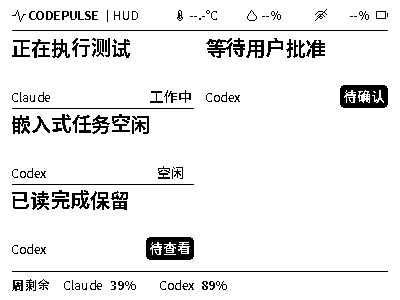
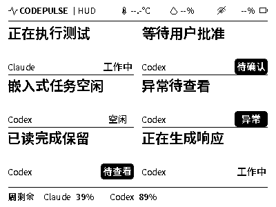
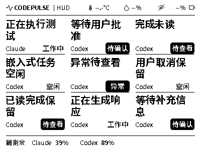

# HUD / 墨水屏工作模型统一交接（2026-10-27）

本次产品基线是 `9af1ffbf83e83211377c7c976b7ad2bffe1e9c26`（已推送）。
以下为该基线之后的未提交工作；产品提交号须在验证并正式提交后补齐，不能把基线当成本次修复提交。
固件核对基线为 `e5e5464`，工作区存在嵌入式会话的未提交修改；本会话没有修改、构建或刷写固件。
桌面生产预览仍为 manifest `0.0.21-retained-session`，两份 C/Wasm 资源未改。

## 需求与已实现的主机行为

- 工作状态卡片统一来自 HudProjection + StatusHub.snapshotForPresentation；LAN 接口、桌面预览与 HUD 共用保留、已读、关闭和恢复规则。
- 空闲、取消和已读终结结果按设置保留（默认 30 分钟）；未读结果及等待用户操作不能被墨水屏另行快速清除。
- 关闭 HUD 任务卡片同步影响墨水屏工作视图；新活动可恢复卡片，额度/心跳更新不恢复。此行为只投影，不修改原始任务。
- 分组、每个原生会话独立一张卡片、顺序和状态层级来自 packages/shared/src/presentation。主进程保存首见顺序；状态变化不把卡片移动到最上方。
- 设备的提供方筛选、9 项分页、used/remaining、环境栏与低闪是设备展示规则，允许独立配置；不是第二套任务生命周期。
- 密集样例按钮常显。Antigravity 新增桌面/HUD 状态适配；本轮不向旧固件启用未知 provider。

## v1 兼容增量（产品侧已实现，嵌入式侧待接入）

现有字段和 protocolVersion=1 不变；旧固件继续读取既有字段并忽略以下新增字段。

| 新字段 | 含义 / 缺省 |
| --- | --- |
| threads[].level | quiet / active / notice / action / fault，缺省可按旧 state 回退 |
| threads[].unread | 当前结果是否未读；缺省按旧行为回退 |
| threads[].groupId | 同一项目的非可逆散列，用于表达同组关系；不包含路径或原生会话 ID |
| agents[].quotaSummary.fiveHourUsedPercent | 与 HUD 底栏相同的 5 小时已用百分比；null 表示没有可显示数据 |
| agents[].quotaSummary.weeklyUsedPercent | 与 HUD 底栏相同的周已用百分比；null 表示未知 |

原 quotas 保持原始窗口、桶与重置时间兼容，保留旧客户端取数能力。
**新 HUD 画面和底栏优先消费 quotaSummary，不再自行按 model/bucket 另选显示值。**
字段缺失才允许回退旧解析；字段存在且为 null 时必须显示未知/省略，不回退成旧数值。
used/remaining 只影响展示换算（剩余 = 100 - 已用），不改变摘要或伪造 0%。
当前 HUD 对 Claude/Kimi 展示双窗口，对 Codex 仅展示周窗口；没有数据的窗口不要补成 0。

层级对应：quiet=空闲/取消/已读终结，active=处理中/执行工具，notice=完成未读，
action=等待授权或补充输入，fault=错误/超时/额度受限且未读。
保留原 state 原因文字，不能让已读 DONE 仍画成“待查看”。用黑白字重、边框和标识体现层级，
不要为层级引入新波形或红色高频刷新。每个会话仍独立，不合并同项目任务。

## 400×300 样例与验收

[4 项数据](fixtures/work-parity/tasks-4.json)、[6 项数据](fixtures/work-parity/tasks-6.json)、[9 项数据](fixtures/work-parity/tasks-9.json)
全部是合成任务，不含用户真实内容、路径、设备身份或密钥。
下面是这些数据经过**当前生产 C/Wasm**得到的真实 400×300 像素，供比较当前限制；不是新布局已通过的证明。

嵌入式验收要求：

1. 四项样例必须保留空闲和已读完成两项，顺序与 JSON 完全一致，不能因为本地超时自行丢弃。
2. 九项样例覆盖全部五种 level；已读完成为 quiet，未读完成为 notice；两种等待均为 action。
3. Claude 摘要已用为 5h 27% / 周 61%，remaining 应为 73% / 39%；Codex 只有周已用 11%（剩余 89%）。单列卡片与常驻底栏均能读到双窗口；密集列可只在底栏显示双窗口，但不得静默丢掉 5h。
4. 相同 project 的不同会话保持各自状态，首见位置稳定；新增任务只在约定位置加入，分页不自动轮转。
5. 字体与排版仍由生产 C 渲染器决定。完成后提供核验过的 Wasm、base64、manifest 和适配器变更，产品侧同步两套预览并验证逐像素一致。

## 刷新与责任边界

任务/已读/关闭/保留配置发生可见变化时及时唤醒条件读取；时间戳心跳不改变 revision。
本次只增加显示语义，不改 PAIR125/试验波形、启动清屏、电源保持或温湿度抑制。
嵌入式侧须检查新增字段参与模型可见变化比较，防止 ETag 变了但模型忽略更新；
按照既有调度完成当前驱动后读取最新状态。实机低闪、残影、刷新耗时和断线恢复均待嵌入式侧验证。

主要接入位置：产品 packages/core/src/aggregate/index.ts 与 shared/types/device*.ts；
固件 main/codepulse_protocol.{h,c}、main/codepulse_ui.h、main/quiet_dashboard.c 及必要的变化比较测试。
当前固件这些文件已有未提交工作，请由嵌入式会话在其改动上继续，不覆盖或重置。

## 检查状态

产品侧已添加任务保留/关闭恢复/顺序重启/双额度摘要的回归，以及 Antigravity 状态与配置测试。
最终类型检查通过；完整构建及最后主进程增量构建通过；666 项回归全部通过。
隔离界面检查通过，1000×720、1120×780、1366×900、1600×1000 均无页面/预览溢出，画布恒为 400×300，样例按钮常显，2 倍检查逐像素一致；HUD 共存、恢复、焦点及工作台隔离检查通过。
本地日志位于 .tmpshots/work-parity-{typecheck,regression,build,surfaces}.log；界面结果位于 .tmpshots/surface-smoke/1793097227235/result.json。
本轮未重启生产后台、修改正在运行的 Agent 配置、进行实机验证或发布新版固件。Antigravity 的真实回调和固件新排版仍待实测。

## 2026-10-28 接手与预览同步

用户已授权当前产品会话直接接手本次固件显示修改和刷写，仍保留两个独立仓库，暂不提交或推送。
固件基线仍为 e5e5464，原有未提交的内容推送实现保留。真实 USB 确认原设备版本为
0.0.22-pair150-trial；本次候选 0.0.23-work-parity-pair150 沿用其波形，不降回 PAIR125。
任务层级、已读语义、共享额度摘要和可见刷新比较已接入，47 组 native C/Wasm 像素验证通过。
两套预览现为 manifest 0.0.23-work-parity；该版本描述显示像素，实际波形由固件构建选项决定。
桌面构建与隔离界面检查通过。固件具体源码、样例、应用哈希与后续刷写/开机验收记录见独立
固件仓库 doc/WORK-PRESENTATION-2026-10-28.md。此前章节的“未修改固件/未重启”等是 10 月 27 日的历史记录。

同日实机回执：0.0.23-work-parity-pair150 已仅写应用区并通过哈希校验；实时 USB 版本匹配，
原配网保留，设备 ready 且 Wi-Fi/桌面连接正常。首次清屏 15,926 ms；一次自然 PAIR150
局部更新驱动 3,136 ms、总耗时 3,286 ms，均 ESP_OK。光学效果与长稳仍待用户验证，未提交/推送。
