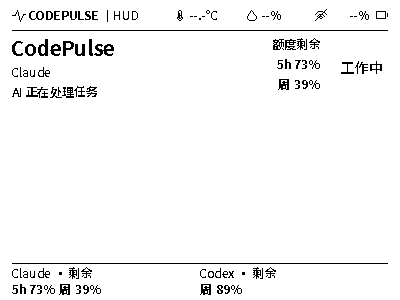
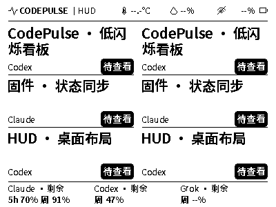

> 历史技术记录；版本与已验证范围以当时正文为准。当前构建、仓库入口和实机状态见 [firmware README](../README.md)。

# 日常低干扰显示 · 2026-10-28

当前状态：0.0.26-region-pair150 已刷入并确认版本、正常开机和 Wi-Fi/桌面连接。
用户已授权本轮固件提交、推送并合入固件 main；CodePulse 开源仓库独立管理，
本次不操作其提交、分支或工作文件。窄窗口仍为默认关闭的实验开关；
实际残影改善及长期光学质量仍待实物验收。以下“未提交/未刷写”是当时的过程记录。

本轮用户要求降低日常残影/闪动，允许设备展示中的局部节奏和状态简化；红色搁置。
基线：产品 f275dab，固件 86d79ce，实机 0.0.25-manual-pair150。两个仓库独立管理。

目标与验收：
- 同一活动任务的 thinking/tool_running 等子阶段不反复驱动；统一显示工作中及中性说明。
- 新任务、完成未读、待授权、待补充、异常和解除提醒保持及时；不更改共享任务、顺序或已读。
- 已知额度按两分钟节奏更新；未知转已知、达到限额及时显示。温湿度仍阈值/15 分钟，避免跟随工作更新。
- 同一张图片/便签/内容在停留期间冻结页眉与额度；急迫提醒撤掉内容后立即恢复工作。
- 不增加全刷/手动清洁依赖，不改 PAIR150、电压、字体尺寸、面板复位、高压关断和失败锁止。
- 窄窗口作为默认关闭的独立实验开关：0x90 按 8px 对齐，只上传真实 OLD/NEW 对应行片；
  每次仍只有一个矩形/一次驱动，不将多个卡片拆成多次刷屏。至少 16px 宽，边界不越过 400×300。

协议：不增加字段。仍消费共享 HUD 状态，减频与中性活动说明仅属于设备呈现。
同一生产 C 渲染器同步两套桌面预览；预览是目标像素，不模拟物理延迟或光学残影。
参考已有 legacy 命令族的 UC8176 R90 partial-window 说明（横向按 bank 对齐、PT_SCAN=0）；
不据参考手册宣称已识别本屏具体 IC 或窄窗口已实测。

候选完成后补充软件模拟的刷新次数、驱动面积、400×300 示例、构建哈希和待实测项。
现有 0.0.25 固件与正在运行的客户端保持为对照，尚未刷写或自动推送本轮改动。

## 软件检查与候选产物

- 协议/刷新策略主机检查通过，PAIR125/PAIR150 × 原始/窄窗口 4 组驱动及生命周期检查通过。
- 含左右边界、至少两 bank、逐行 OLD/NEW 步长、每一命令/行传输失败、高压关断与故障锁止。
- 连续 120 次活动子状态切换重放仅 1 次额度刷屏；同一内容 600 次后台变化为 0 次刷屏；必要提醒与读态未被吞掉。
- 六任务示例的变化范围为 32×13；旧整行窗口为 400×13，对该示例减少 92% 面积，不代表每次更新都能达到此比例。
- 65 组 native/Wasm 像素一致；400 次交错渲染通过。两套预览逐字节一致，桌面构建通过。
- `0.0.26-region-pair150` 构建通过，应用 1509728 字节，剩余 26272 字节；分区不变。
- 应用 SHA-256 `a20f8a157aff13ec8a420ec044e73748f84da70386afeffab3cbab9c622351bc`；Wasm SHA-256 `5d30ff9317eb88d4f04141f1851ed2388d3078f254b1afe002758309101821f1`。
- 仅准备候选，未提交、未推送、未刷入；物理残影、窄窗口表现和刷新耗时待实测。
- 当前运行中的客户端未重启，仍使用原先预览；同一协议允许原客户端连接新候选，后续可正常切换新预览。

## 400×300 生产示例

## 本次刷写尝试：未写入，等待恢复 USB

用户确认按住供电键后，esptool 在打开串口阶段返回拒绝访问，未开始写入。
同时发现本机异常日志不是 UTF-8；本地刷写工具已能容错读取，不影响 ASCII
写后校验的严格成功条件。随后通过 CodePulse 自身 app.quit 正常退出以释放串口，
再次校验时 USB 目标已不可见，检查主动停止，仍未写入。

客户端已带 LAN 服务恢复启动，健康检查通过。已请用户完全松开、正常开机，
先恢复 USB 并停止设备扫描，再安排下一次刷写。运行预览已为 0.0.26，
实体固件未由此次尝试替换；候选仍未提交、未推送、未实机验收。

## 成功刷写与正常开机回执

恢复正常开机后，已通过客户端既有 stop-device-scan 接口停止所有本地窗口的
扫描，并完成串口可打开检查。用户再次确认按住功能/电源键后，仅写应用区
0x10000，6.8 秒写入完成，esptool 返回 0 且写入哈希校验通过。保留 NVS 与分区，
没有自动复位。此前失败尝试未开始写入；本节为其后的成功结果。

用户正常松开、重新开机，USB 实时身份确认 0.0.26-region-pair150，最终 ready，
原配网保留，Wi-Fi 与桌面连接均正常。首次清屏 15.922 秒 ESP_OK；之后约 45 秒
观察未见局刷或故障。这仅为当前工作负载的观察，不作为同负载的残影 A/B 证明。
当前客户端/两套预览已构建并切换，LAN 服务保持正常。继续被动观察自然更新，
不向真实任务注入演示事件或人为触发额外刷屏。光学验收仍由用户实物反馈确认。
本轮候选未提交、未推送，原 0.0.25 构建和回执保留。

## 补充自然更新观察

再次只读确认版本与 ready 后，被动观察约 90 秒，未捕获局刷或故障；
观察已正常结束并释放串口。此结果仅描述该时段的工作负载，不能证明
真实状态变化下的窄窗口或残影已经通过光学验收。首次清屏的成功证据在
paced-boot-receipt 中；本段 live 回执未再次清屏，不能将其 false 解读为启动失败。
客户端、LAN 服务正常运行，本轮源代码仍未提交、未推送，等待用户日常体验。

## 主分支集成

远端 main 在 8f6d3f9 已合并此前 0.0.25，源码树与本轮开发基线 86d79ce 一致。
本轮先将开发分支快进至该主线基线，保留全部未提交文件，再提交 0.0.26 的
显示减频、稳定活动说明及可选窄窗口实现、验证和实机回执。
协议字段、默认窄窗口开关、PAIR125/PAIR150 选项、供电及失败保护保持原约定。
本次集成不重复刷机；外壳资料和私有运行日志继续留在本地。
